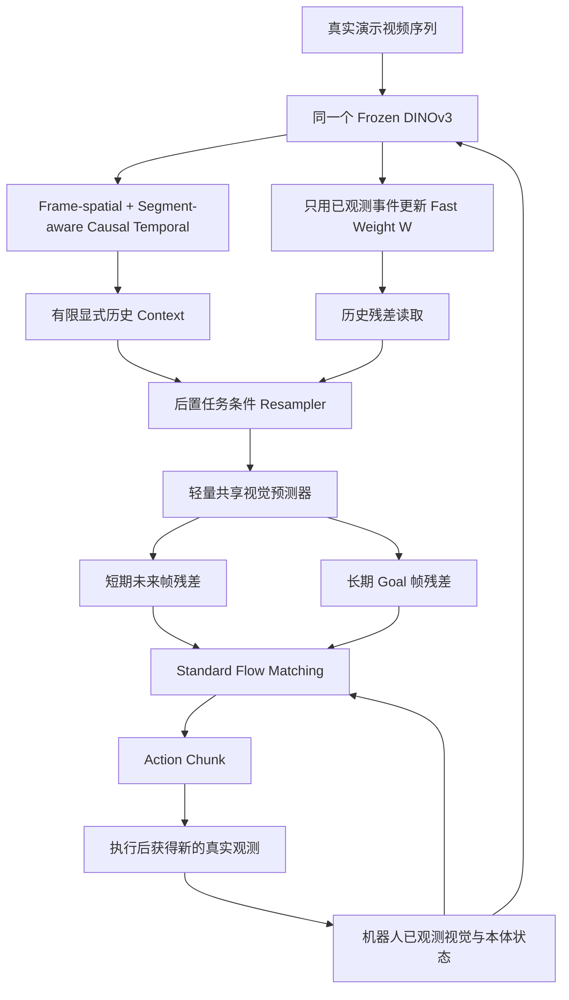

# ResWAM Starter · v0.1

> **研究原型 / Research Prototype。** 统一因果视频历史、单一在线 Fast-Weight 记忆、恰好两个视觉潜在残差帧（Short / Goal）、标准条件 Flow Matching 动作生成。**不生成未来 RGB 视频、不使用大型 VLM、无 RollFlow、无预测历史缓存。**

## 方案不是最终标准

> **重要：`docs/PLAN.md` 仅作为当前研究参考，不代表已经证明正确或最优。后续必须依据实际训练曲线、闭环成功率、内存/延迟、消融结果与失败分析持续迭代、更新并优化；发现无效模块应简化或删除。任何新设计都必须先验证再改方案。**
>
> 本项目当前只完成结构原型与 CPU 合成特征实验；并未验证官方 TTT-RM 全量复现、真实 DINOv3 预训练推理、LIBERO/SynthICL/Imitator Game 闭环成绩或约 70 ms 的部署目标。

## 固定架构



- 短期：`delta_short = Y(robot[t+h_short]) - Y(robot[t])`
- 长期：`delta_goal = Y(robot[goal]) - Y(robot[t])`
- `Y` 是固定 DINO patch 空间池化投影；标签来自机器人成功示范，不是人类视频 Patch 直接相减。
- **预测不写历史。** 两组 Delta 仅用于当次 FM 动作条件；下一次真实观测重新预测。
- Demo 与 Robot 都采用统一时间前缀的因果模型，但不同 segment 的 **Patch-index Temporal Attention 被屏蔽**，只允许全局摘要的信息交互。
- V1 的 `memory_mode=delta` 是 **TTT-RM-inspired 的简化 Normalized Delta-Rule Fast Weights**，不是官方 TTT-RM 算法复现；G3 需离线预训练 History Decoder 并做 Teacher 残差监督。
- `interaction_mode` 当前仅实现 VTA/IDM 的固定双 Delta→FM；Cross/Joint 暂未实现，不能声称已完成。

## 环境安装（优先使用 uv）

Python 3.10+；正式训练建议 NVIDIA GPU，当前 CPU 只能做接口测试与玩具实验。

```bash
cd reswam_starter
uv sync --extra dev
uv run pytest -q
uv run python scripts/smoke.py
```

首次使用指定的视觉编码器会尝试下载 Hugging Face 预训练权重。网络受限时先运行无 timm、无预训练权重的 toy；不能拿 toy 替代正式视觉评估。DINOv3 权重需遵守其模型许可证。

## 用户指定的视觉编码器（保持完全一致）

```python
import timm
model = timm.create_model(
    "vit_small_patch16_dinov3.lvd1689m",
    pretrained=True,
    num_classes=0,
)
model = model.eval()
features = model.forward_features(normalized_image)  # 256x256: [B,261,384]
```

`FrozenDINOv3` 自动依据输入图像与 Patch Size 取最后 `H/16*W/16` 个空间 Tokens，并排除 DINOv3 的 CLS / Register 特殊 Tokens；调用 `vis.make_transform()` 可获取 timm 官方标准预处理。

可在 GPU + 网络正常时运行：

```bash
uv run python scripts/check_dinov3.py --image /path/to/image.png
```

## 可立即重现的实验

**1. CPU 结构与梯度检查**

```bash
uv run pytest -q tests
uv run python scripts/smoke.py
```

**2. 真实需要历史信息的 Toy（关键事件被显式缓存丢弃）**

```bash
uv run python scripts/train_toy.py --task occluded --steps 250 --seed 7 --memory delta --output runs/official/occluded_with_memory.json
uv run python scripts/train_toy.py --task occluded --steps 250 --seed 7 --memory none  --output runs/official/occluded_without_memory.json
```

模拟任务中，演示只有中间帧暴露 ±1 的隐藏任务信息；显式历史只保留演示首尾中性帧，机器人当前观测相同。两组模型参数初始化、动作 FM、监督目标基本一致，仅在线快速权重是否可用不同。注意关闭记忆会带来细微参数差异；该实验是功能性验证，正式论文需严格参数和算力配平。

**3. 从真实图像构造 DINO 特征缓存与训练入口**

详见 [`docs/DATA_PROTOCOL.md`](docs/DATA_PROTOCOL.md)。

```bash
uv run python scripts/cache_features.py --manifest /path/to/manifest.json --output runs/official/dino_features.pt
uv run python scripts/train_encoded.py --data runs/official/dino_features.pt --steps 1000 --grad-accum 4 --output runs/official/encoded_train.pt
```

`train_encoded.py` 是第一个 G1/G2 数据接入入口，不是完整离线多回合 TTT-RM 训练，更不是机器人在线环境评测。若要先离线验证数据协议：

```bash
uv run python scripts/make_toy_cache.py
uv run python scripts/train_encoded.py --data runs/tmp/toy_encoded.pt --tiny --steps 10 --grad-accum 2 --output runs/official/debug.pt
```

## 当前状态（2026-11-11）

| Gate | 进展 | 说明 |
| --- | --- | --- |
| G0：项目可运行 | **原型已通过** | CPU 测试与 toy 正向/反向传播；尚未接真实机器人 |
| G1：统一因果 Video ICL | **结构完成 / 未真实训练** | Segment-aware mask、前缀 history、显式缓存 |
| G2：双帧 Residual + FM | **结构完成 / Toy 训练完成** | 预测两个 Frame Delta、标准 FM；未对真实 benchmark 验收 |
| G3：TTT-RM | **Writer/Reader + Offline Decoder 原型** | 尚未预训练 decoder 与正式 TTT-RM 消融 |
| G4：真实闭环 / Latency / Joint | **未开始** | 需要真实数据和仿真评测环境 |

### 实测摘要：合成潜在特征“隐藏事件”实验

3 个随机种子 `7/17/27`，每组训练 250 步，batch=24，held-out 64 个合成样本。使用当前**加入时间位置与段嵌入后的 v0.1 代码**；历史的旧版 JSON 单独留档。**非真实 DINO 视觉、非 LIBERO 成功率。**

| 模型 | Goal 方向准确率 | Goal MSE | FM 动作方向准确率 |
|---|---:|---:|---:|
| Fast Weight (`delta`) | 100.0% | 0.00191 | 100.0% |
| No Memory (`none`) | 49.5% | 0.06524 | 49.5% |

结果说明最小实现具备隐藏历史事件驱动预测和动作的基本能力；不能由此推出跨本体视频 ICL、真实长时操作成功或官方 TTT-RM 的有效性。

## 目录

```text
reswam_starter/
├── src/reswam/          # 模型与数据协议
├── scripts/             # smoke、toy、特征预处理、训练脚本
├── tests/               # 因果、重置、梯度、特征形状与数据合同
├── configs/base.yaml    # 正式视觉骨干与基准配置
├── docs/PLAN.md         # 滚动更新的研究方案（不是不可修改的定案）
├── docs/EXPERIMENT_LOG.md
├── docs/DATA_PROTOCOL.md
├── runs/official/       # 本次记录的原始 JSON 结果
└── runs/tmp/            # 本次运行的临时缓存，按需单独清理
```

## 下一轮研究任务

1. 用真实 SynthICL/Imitator Game 的配对演示与机器人轨迹替换 toy，建立可靠的无 TTT 视频 ICL 训练与闭环评估。
2. 验证 DINOv3 时空 Patch Delta 的时间一致性、背景鲁棒性、以及跨机器人/人类视觉视角的任务效果对齐。
3. 完成 G3 Offline History Decoder 的预训练和 residual memory outer loss，对照普通 KVB / Linear Attention、等容量显式缓存。
4. 添加训练记录的多种子方差、权重检查点、环境交互成功率、端到端 p95 延迟与 GPU 小时数。
5. 如果视频目标有效但 FM 忽略未来 Delta，进一步比较 IDM 与轻量 Cross-Attention，而不是先移植大型视频 MoT。

**当前版本不是最终设计。始终根据验证结果修改 `docs/PLAN.md`、配置、测试、结论；每次迭代保留旧结果，避免只留下最好的一次实验。**
