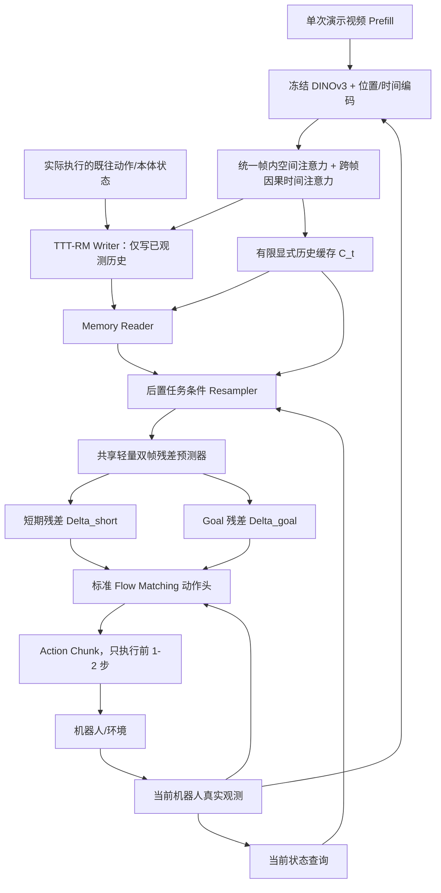

# ResWAM v8.0 — 开工版：统一因果历史、TTT-RM、双帧残差、标准 Flow Matching

日期：2026-11-11 ｜ 状态：可执行研究计划（尚未实证验证）

## 0. 固定设计决定

- **任务：** 单次原生视频演示指定陌生操作任务；机器人根据演示及自身真实历史闭环执行，不依赖大型 VLM。
- **历史：** `[DEMO frames, SEG_END, ROBOT observations and executed actions]`；演示是参考序列，机器人历史是实际执行，不构造跨段物理转移。
- **记忆：** 固定预算显式上下文 `C_t` + 一份 TTT-RM Fast Weights `W_t`；在线只由**已观测/已验证事件**更新。演示帧也属于真实给定的参考证据，但其运动不视为机器人实际运动。
- **视觉预测：** 始终**恰好两帧**紧凑视觉潜在残差（短期 `Delta_short`、长期 Goal `Delta_goal`），不生成完整 RGB 视频，不训练视频 DiT/VAE，不引入更多未来帧头。
- **动作：** 标准条件 Flow Matching 生成 Action Chunk；第一版采用 IDM/VTA：先一次预测两帧残差，再据此生成动作。
- **预测缓存：** **没有** Pending Predictions。两帧残差仅在本轮动作计算中作为临时张量使用，动作产生后即可丢弃；每一轮用新真实观测重新预测，不把旧预测当作历史。
- **在线适应边界：** V1 实现历史条件的滚动闭环重规划和 TTT-RM 观测写入，**不声称**已经实现根据旧预测误差进行梯度式动力学校准。

## 1. 单轮推理信息流（无预测缓存）



说明：图中的回路代表**下一轮控制**，不是单次 forward 的循环依赖。演示预填充只在任务开始时进行一次；当前观测追加到 ROBOT 段末尾。

## 2. 视觉表征与因果时空模块

### 2.1 统一因果序列

`[DEMO_START, d_1,...,d_N, SEG_END, ROBOT_START, (o_0,s_0), (o_1,s_1,a^exec_0),...,(o_t,s_t,a^exec_{t-1})]`

- 同一**帧内**所有 patch 可双向做空间注意力（整帧已经观测）；**跨帧**只允许读取当前及更早帧。
- 演示序列完整 prefill 后，在线追加机器人观测；本轮没有任何未来机器人帧、目标标签或未执行动作写入历史。
- 不用两套独立的时间编码器，但必须带 segment/time/camera/presence mask。**跨演示/机器人段不要将相同 patch index 误当作同一个物体位置**：跨段通过 pooled/event token 或查询式 attention 检索；同段内部可使用按空间位置因子化的 temporal attention。
- 优先采用 `Spatial Self-Attention`（每帧）与 `Causal Temporal Self-Attention`（帧间），参考 SynthICL 的 `Latte` 实现，但在线部分需要 causal mask 与缓存支持。
- 冻结 DINOv3，演示特征可预先编码缓存；在线只需编码新观测，避免每个动作周期重算整段演示。

### 2.2 不过早无条件压缩

- DINOv3 后尽可能保留有空间位置的 patch features，在局部历史编码与 TTT Writer 前**不使用不可逆的极端压缩**。
- **显式缓存**可限制为少量关键帧、事件和最近 2–4 帧的 feature tokens；不要求无限保存全部 dense patches。
- **后置任务条件 Resampler** 接受当前视觉、显式历史与 TTT Readout，用 `q_short`、`q_goal` 对时空历史做任务条件化读取，产生少量预测上下文 token。
- Writer 独立于后置 Resampler；Reader 参与 Resampler，杜绝 `Writer -> Resampler -> Reader -> Writer` 的同轮循环依赖。
- 初始 benchmark：每帧视觉 token 保留预算 32/64，任务查询读出预算 16/32；需按显存、成功率实测。

### 2.3 残差的稳定监督坐标

- 定义固定目标映射 `Y(o)=P_fixed(E_frozen(o))`，同一机器人相机、相同投影/位置约定下比较同任务不同时间的视觉状态。
- `P_fixed` 可以是固定空间池化/冻结目标 Resampler，**不可每帧用不同任务 Query 后直接逐索引相减**。
- 监督标签对机器人训练轨迹定义：`Delta_short* = Y(o_{t+h_s}) - Y(o_t)`；`Delta_goal* = Y(o_goal) - Y(o_t)`。
- `o_goal` 来自该任务成功机器人轨迹的目标图像/末帧（首版固定协议）；**不能直接将人类演示末帧与机器人当前 patch 相减**。
- 仅使用训练时的未来真实帧构造 loss labels，决策时不向模型输入未来帧，避免信息泄露。若相机/物体移动导致 patch 无法一一对应，加入空间匹配/不变性消融，不假设逐 patch 差必然是物理运动。

## 3. 模型结构

### 3.1 统一历史记忆

给定观测事件 `x_t=EventEncoder(visual_features, observed_proprio, executed_action_prev, timestamp, segment_id)`：

`W_t = U(W_{t-1}, key(x_t), value(x_t))`

- TTT-RM 风格：部署时通过视觉/事件 K-V 自监督更新单一 Fast Weights；`History Decoder` **只在离线训练**用于构造当前显式上下文无法恢复的历史特征残差。
- 用 normalized Delta Rule 作为最小易复现起点，但它不是原论文全部实现；随后对比原版 KVB、等容量线性注意力、只用显式缓存。
- 学习目标必须包含动作 FM 或未来残差对记忆的使用监督，否则可能记住无关背景。
- 如果演示通过 TBPTT 全部被 `detach`、又无演示动作标签，可能得不到跨演示的任务梯度；短前缀保持至机器人第一训练窗口的可微联通，或使用辅助蒸馏/前缀读出监督。

### 3.2 恰好两个未来残差帧

`z_t = Y(o_t)`（固定监督坐标，不意味着 `Y` 的所有路径均需梯度）。

`[Delta_hat_short, Delta_hat_goal] = ResidualTransformer(z_t, resampled_context, q_short, q_goal)`

- 共享 4–6 层小型 Transformer，d_model≈384 的初始候选；每个查询输出一个 K×d 的残差帧 token 集。
- Short 的监督 `h_s` 初期选固定时距（例如 4 个对齐视觉帧），Goal 的监督采用任务成功终态；**总输出数量始终为 2**。
- 两个输出可由一个视觉损失合并：`L_visual = λ_s L_short + λ_g L_goal`。
- **Short 在当前 VTA/IDM 中是专家示范条件下期望发生的短期变化，不是给定动作后的无条件真实动力学预测**。所以不以“真实执行与 Short 的误差”直接训练动作条件动力学 TTT。

### 3.3 标准 Flow Matching Action Head

`c_t = Fuse(current_robot_visual, proprio, predicted_Delta_short, predicted_Delta_goal)`

`A_t = FlowMatchPolicy(noisy_action, flow_time, c_t)`，保持 SynthICL 标准 FM 损失与 Action Chunk 维度。

- **训练/推理统一用模型预测的两个 Delta 作动作条件**，真实未来 Delta 仅作为监督标签；可以额外统计 Oracle-Delta 上限，但不作为正式推理成绩。
- 第一个正式架构是 IDM/VTA。下一步切换 Cross-Attention：FM 多层直接读取固定残差 token；Joint 必须另外定义反向信息流的训练/采样规则，**不是只换 mask 就自然等价**。
- 为验证 Delta 不是被忽略的辅助输入，做 `zero/shuffle/swap short/goal` 因果消融和相同当前图像不同演示的任务切换。

## 4. 在线 `step()` 合同与伪代码

```python
model.reset_task()
for frame in demo_video:
    model.observe(frame, segment='DEMO')  # 真实给定演示，仅一次 prefill
model.end_segment()

while not done:
    obs = robot.observe()                  # 必须是已观测事实
    z = model.encode(obs.rgb)
    model.observe_features(
        z, proprio=obs.proprio,
        previous_executed_action=last_actual_action,
        segment='ROBOT', timestamp=obs.timestamp
    )                                      # 仅一次历史写入

    delta_short, delta_goal = model.predict_two_deltas()
    actions = model.flow_action(delta_short, delta_goal, obs.proprio)
    del delta_short, delta_goal             # 仅本轮的临时预测，不存储

    last_actual_action = robot.execute_first(actions, n_steps=1)  # 使用真实执行日志
```

关键：若异步执行，必须知道当前观测对应的真实执行动作与时间，**但这需要动作执行日志，不需要预测结果缓存**。传感器异常、段边界或 reset 时不伪造时序转移。

## 5. 离线训练目标

`L = L_FM + λ_v (λ_s L_short + λ_g L_goal) + λ_m L_RM`

- `L_FM`：机器人示范动作 Chunk 的标准 Conditional Flow Matching。
- `L_short`, `L_goal`：模型预测的两帧残差对稳定 latent target 的回归。
- `L_RM`：TTT-RM 离线 History Decoder 给出的**互补历史残差**监督，同时通过 FM/视觉 loss 让记忆服务下游决策。
- `History Decoder` 的预训练目标 `L_HD` **是一个独立预训练阶段**，不是部署时额外预测头。
- 任务配对：`[演示 D_task, 机器人轨迹 task]`；必须包含“同当前观测、不同演示、不同目标动作”的困难负例与物体交换等对立任务。

## 6. 分阶段实施（每阶段均输出可复现实验报告）

| Gate | 内容 | 硬验收 |
|---|---|---|
| G0 基线 | 核查 SynthICL checkpoint/闭环数据管线/动作控制 | 官方或可信数据闭环，解决已知 0/60 异常，确保未来监督无泄漏 |
| G1 因果 ICL | 统一 demo + robot 的因果历史，先不用 TTT，固定 FM | 同图不同演示，动作随任务正确切换；流式与完整前缀输出一致 |
| G2 双帧 ResWAM | 固定目标投影、Short/Goal 预测；FM 用预测 Delta | 对比无 Delta、Short-only、Goal-only、双 Delta、真实 Delta 仅 Oracle |
| G3 TTT-RM | 历史教师 + 单 W writer/reader + bounded context | 历史遮挡/计数提升；与普通 KV 和记忆预算相等对比；无任务遗忘 |
| G4 闭环与架构消融 | 滚动预测与实际执行；IDM vs Cross | p50/p95 端到端延迟、成功率、显存、漂移和鲁棒性；目标约 70 ms 必须实测 |
| G5 可选扩展 | 真实反馈的预测误差显式适应 | 仅在确定增加复杂度值得后单独立项；不要污染 V1 |

## 7. 不可跳过的单元/对照实验

- **因果无泄漏**：改变 `o_{t+1:}` 的训练数据，不得影响时刻 `t` 的动作输入与记忆读出。
- **前缀一致性**：离线整条序列的 causal 结果与在线 incremental 更新结果（浮点误差范围内）一致。
- **跨段空间伪对应**：更换人类视角/机器人视角，检查跨段 temporal-attention 是否误用同 patch 索引。
- **单次写入**：演示预填充一次、每个机器人新观测在线写入一次，旧预测永不写入 `W`。
- **目标标签正确**：`goal` 来自机器人任务监督，演示只条件化，不做跨本体原始 patch 减法。
- **TTT 可恢复**：重置 task、reset episode 时 `W_demo` 恢复/保留协议明确；每轮无预测缓存状态。
- **FM 防捷径**：擦除/置乱 short/goal、打乱演示、遮挡历史，动作和成功率相应变化。
- **评价公平**：同数据、视觉骨干、训练步数、动作时长、硬件配置；多随机种子，比较闭环任务指标、GPU-hours、峰值 VRAM、p95。

## 8. 推荐目录与工程纪律

```text
reswam_v8/
  config.py            # 一处控制超参数与架构模式
  events.py            # Segment/Time/Observed/Executed 合同
  vision.py            # Frozen DINOv3 / Fixed latent target
  causal_context.py    # Frame-spatial + segment-aware temporal causal
  memory.py            # Bounded context + TTT-RM writer/reader
  history_teacher.py   # Offline only
  resampler.py         # Late task-conditioned query attention
  residual.py          # Exactly two frames: short/goal
  action_fm.py         # Existing standard Flow Matching wrapper
  model.py             # reset/prefill/observe/predict
  evaluate.py          # success, robustness, latency
  tests/               # leakage, reset, alignment, token positions
```

- `uv` 创建隔离环境；不直接改动稳定策略主干，创建可回退的 v8 policy。
- 临时输出 `runs/tmp/<run_id>`，正式输出 `runs/official/<run_id>`，只清理由本 run 创建的临时文件。
- 先最小 smoke、数据对齐、梯度测试，再正式多卡训练；禁止仅凭 loss 下降宣布成功。

## 9. 主要研究参考

- [SynthICL](https://github.com/sNiper-Qian/synthicl) — 视频 ICL、Latte 分解式时空注意力、标准 FM。
- [TTT-RM](https://arxiv.org/html/2610.04701) — 互补历史解码器与 Fast-Weight 写入。
- [ContextFlow](https://github.com/dingjiansw101/ContextFlow) — 上下文压缩、专家分工、条件 FM。
- [BPP](https://github.com/real-stanford/behavior_prompting) — 演示的时序阶段检索与视频提示。
- [LiLa-WAM](https://github.com/teee000/LiLa-WAM) — 视觉任务 Delta 与动作生成。
- [EasyWAM](https://github.com/OpenMOSS/EasyWAM) — IDM/Joint/MoT 可配置信息流实验；**只借鉴思路，不引入视频扩散骨干**。

## 10. 一句话研究主张

**过去只存可验证的观测证据；TTT-RM 学会补足有限上下文无法恢复的信息；ResWAM 每一轮只预测两个任务相关的未来潜在残差帧；标准 FM 根据其生成动作；新真实观测让系统持续闭环重规划。**

此方案是合理的可检验基准，不等于已经证明最优；架构真实性由 Gate G0–G4 的实验结果决定。
